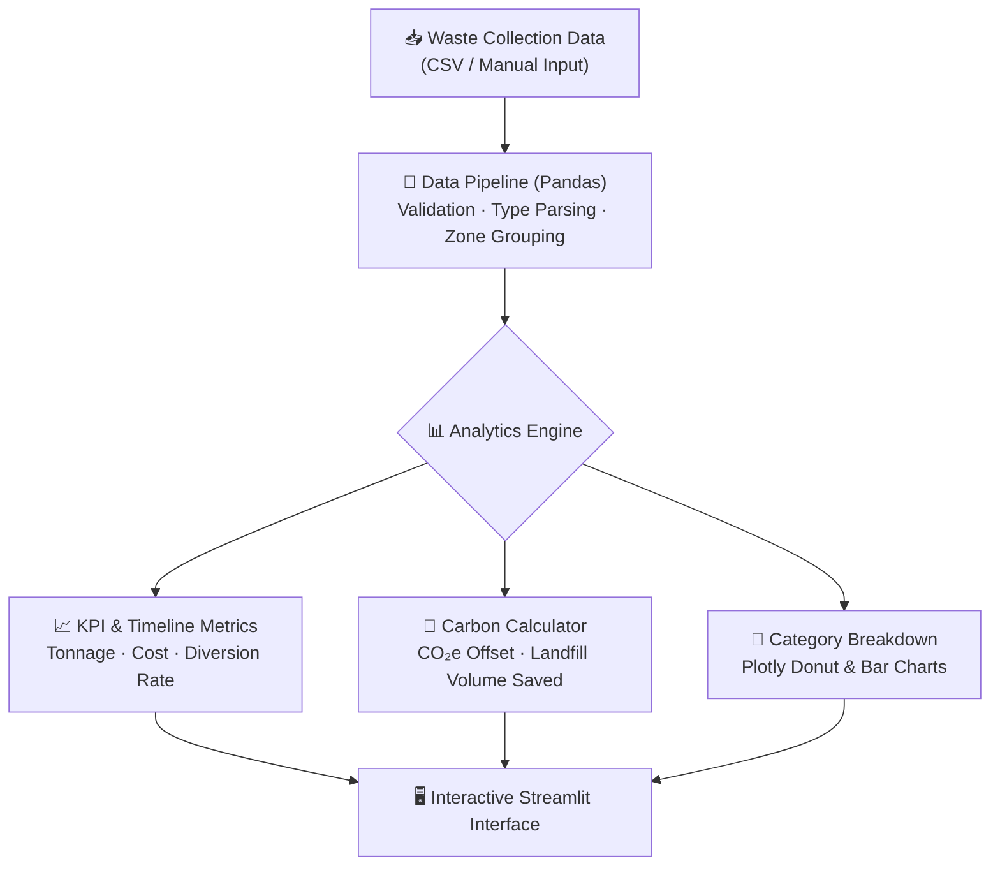

<p align="center">
  
</p>

<p align="center">
  
  
  
  
  
  
</p>

---

## 📋 Executive Summary

Rapid urbanization has intensified municipal solid waste management challenges. Traditional waste tracking relies heavily on fragmented logs and retrospective audits, making it difficult for civic administrators to optimize segregation efficiency, identify underperforming collection zones, and quantify environmental offsets.

**EcoTrack** is a centralized waste intelligence and analytics web application developed with **Python**, **Streamlit**, **Pandas**, and **Plotly**. It equips municipal authorities, facility supervisors, and sustainability stakeholders with real-time operational visibility into daily waste collection volumes, segregation compliance, and ecological benefits (including carbon offset calculations and landfill space conservation).

---

## 📑 Table of Contents

- [Key Features & Capabilities](#-key-features--capabilities)
- [System Architecture & Data Flow](#-system-architecture--data-flow)
- [Tech Stack Breakdown](#-tech-stack-breakdown)
- [Quickstart & Local Execution](#-quickstart--local-execution)
- [Project Directory Layout](#-project-directory-layout)
- [Author & Contributions](#-author--contributions)

---

## ✨ Key Features & Capabilities

- **Real-Time Operational Dashboard** — Live KPI overview displaying total waste tonnage, diversion rate percentage, operating logistics costs, and active collection zones.
- **Interactive Multi-Domain Analytics** — Plotly-driven visualizations including category breakdown donut charts, timeline trends across dates, and zone-level comparison bars.
- **Dynamic Waste Logging & Data Ingestion** — Upload custom `.csv` or `.xlsx` logs, apply real-time filters by category/zone/recyclability, and dynamically log new collection batches in session.
- **Environmental Impact & Carbon Calculator** — Formulated computations assessing metric tons of CO₂ equivalent avoided, mature trees saved, electrical energy conserved (kWh), and landfill volume spared ($m^3$).
- **Color-Coded Segregation Taxonomy** — Standardized operational guidelines (Organic/Wet, Recyclable Dry, Domestic Hazardous, and E-Waste).

---

## 🏗️ System Architecture & Data Flow



---

## 🛠️ Tech Stack Breakdown

| Category | Technology | Purpose |
|----------|------------|---------|
| **Core Language** | Python 3.9+ | Application logic and analytics execution |
| **Interactive UI** | Streamlit | Responsive browser-based dashboard interface |
| **Data Processing** | Pandas | Dataframe transformations, cleansing, and aggregations |
| **Visualization** | Plotly Express & Graph Objects | Dynamic charting, interactive gauges, and timeline distributions |
| **Deployment** | Streamlit Cloud / Docker | Containerized and cloud-hosted application access |

---

## 🚀 Quickstart & Local Execution

### Prerequisites

- Python 3.9 or higher
- `pip` package manager

### Installation & Launch

```bash
# 1. Clone the repository
git clone https://github.com/Chaturyathukivakam/Garbage-System.git
cd Garbage-System

# 2. Set up virtual environment
python -m venv venv
source venv/bin/activate       # On Windows: venv\Scripts\activate

# 3. Install dependencies
pip install -r requirements.txt

# 4. Launch the application
streamlit run app.py
```

The application will automatically start and open in your default browser at `http://localhost:8501`.

---

## 📂 Project Directory Layout

```
Garbage-System/
├── app.py                                    # Main Streamlit analytics application
├── requirements.txt                          # Python dependencies
├── presentation.html                         # Interactive browser presentation deck
├── Alliance_Garbage_Management_Presentation.pptx # Project presentation slide deck
├── Garbage_Management_System_Presentation.pptx  # Summary presentation
├── .streamlit/
│   └── config.toml                           # Streamlit server & UI theme config
├── data/
│   └── sample_waste_data.csv                 # Standardized reference dataset
└── README.md                                 # Technical documentation
```

---

## 👤 Author & Contributions

**Thukivakam Chaturya**

[](https://github.com/Chaturyathukivakam)
[](https://www.linkedin.com/in/thukivakam-chaturya-206023326/)
[](https://chaturyathukivakam.github.io/3D-Portfolio/)

---

<p align="center">
  
</p>
